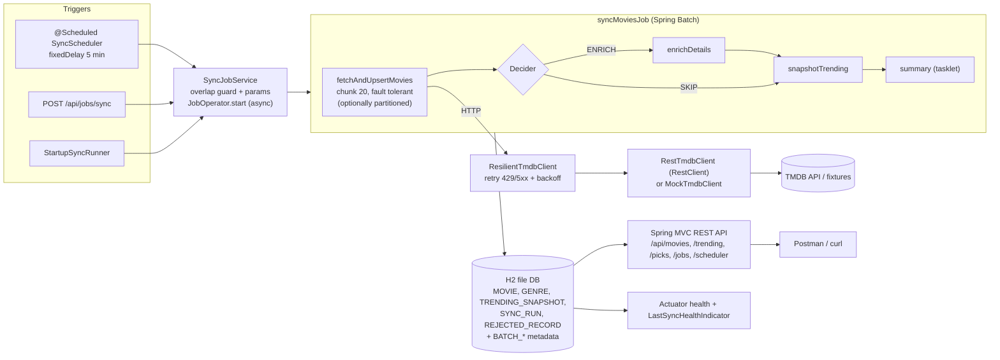

# Interview prep — Movie Picker

How to use this: read the architecture once, memorise the 2-minute pitch, then drill the Q&A **out loud** (cover the answer,
say it, compare). Every answer ends with a pointer to the file in *this* repository that proves it — in an interview,
"in my project I did X, here is why" beats a textbook definition. Section 4 has the scenario questions interviewers love.

Spring versions used: Boot **4.1.2** · Framework **7.0** · Batch **6.0.6** · Hibernate **7** · Jackson **3**. Many tutorials
online describe Batch 4/5 (`JobBuilderFactory`, `JobLauncher`, `JobExplorer`) — those are gone/deprecated here.

---

## 1. Architecture

Layering: `web` (controllers, DTOs, ProblemDetail) → `service` (rules, transactions, mapping) → `repository` (Spring Data) →
`domain` (JPA entities). Batch code lives in `batch/`, the scheduler in `scheduler/`, the TMDB client in `tmdb/`.

---

## 2. The 2-minute pitch (say it, don't read it)

> "Movie Picker is a Spring Boot 4 / Spring Batch 6 project I built to learn batch processing properly.
> A scheduled job pulls movies from the TMDB API and upserts them into a database through JPA; a REST API serves the data and
> also controls the job.
>
> The job, `syncMoviesJob`, is a flow of four steps: a chunk-oriented step that reads TMDB pages and upserts movies in chunks of
> twenty; a decider that decides whether the enrichment step is needed; an enrichment step that fetches details for new movies;
> a snapshot step that records the trending ranking; and a tasklet that writes one summary line.
>
> What I care about is behaving well when things go wrong. The HTTP client retries 429 and 5xx with exponential backoff and honours
> Retry-After; corrupt records are skipped up to a limit and stored in a rejected-records table; business filters return null from
> the processor so they are not errors. Because the reader saves its position in the step execution context in the same
> transaction as the data, a failed run can be restarted and resumes exactly where it stopped — I demonstrated it by failing a
> run on page two of one list and restarting it with no duplicates. The writer is an idempotent upsert keyed on the TMDB id, so
> re-processing is always safe.
>
> It's scheduled with fixedDelay, with an overlap guard and zombie-execution recovery; there's an optional partitioned
> mode — one worker per list — where I hit a real race between workers inserting the same movie and fixed it by serialising the
> database write while keeping the HTTP reads parallel. The API returns DTOs with ProblemDetail errors, 202 for long operations,
> and I tested everything end to end against real H2 and a real stub HTTP server. Known limits: the overlap guard is
> single-JVM — for several pods I'd add ShedLock or partition by disjoint keys — and I verified against a mock of the TMDB API."

---

## 3. Questions and answers

### 3.1 Spring Batch fundamentals

**Q1. Job vs JobInstance vs JobExecution vs StepExecution?**
Job = the definition. JobInstance = a *logical run*: job name + **identifying** parameters. JobExecution = one *attempt* of an instance
(a failed instance can have many). StepExecution = one attempt of one step within an execution, with the counters.
→ `service/SyncJobService.java` (params), `docs/LEARNING_LOG.md` Phase 6, `MovieSyncJobRestartTest` (1 instance, 2 executions).

**Q2. What is a chunk-oriented step?**
Read items one by one, process each, collect `chunkSize` results, write them together, all in **one transaction** per chunk; then commit
and persist progress. → `batch/MovieSyncJobConfig.java` (`chunk(sync.chunkSize())`).

**Q3. Chunk vs tasklet?**
A tasklet is a single `execute()` repeated until finished, inside one transaction — good for housekeeping (summary row, cleanup), bad
for bulk data (no per-item skip/retry, a huge transaction). → `batch/SummaryTasklet.java` vs the fetch step.

**Q4. How do you choose the chunk size?**
It is the transaction size and the commit/rollback granularity: bigger = fewer commits, less overhead, more memory, more redo after a
failure, longer locks. Smaller = the opposite. Align it with `hibernate.jdbc.batch_size` so one chunk = one JDBC batch. We use 20 (also
TMDB's page size). → `application.yml` (`sync.chunk-size`, `jdbc.batch_size`).

**Q5. Processor returns null vs throws?**
`null` = filter: `FILTER_COUNT++`, never reaches the writer, no rollback. Exception = failure: rollback, and skip/retry rules apply.
→ `batch/MovieItemProcessor.java`, `MovieItemProcessorTest`.

**Q6. What is an ItemStream and why does the reader implement it?**
`open/update/close`. `update` is called before each chunk commit and its data is saved to `BATCH_STEP_EXECUTION_CONTEXT` in the same
transaction; `open` restores it on restart. → `batch/TmdbMovieReader.java`.

**Q7. Why a custom reader?**
Batch has no REST reader, and `AbstractPaginatedDataItemReader` assumes one source with a fixed page size, while we walk several
lists of different lengths. We store `(listIndex, page, offset)` ourselves. → `TmdbMovieReader` Javadoc.

**Q8. What is `@StepScope` and why use it?**
A bean created lazily *per step execution*. Needed for (a) mutable state — a singleton reader would carry its position into the next run;
(b) late binding of `#{jobParameters[...]}` / `#{stepExecutionContext[...]}`. Spring injects a proxy, so the return type must be the class.
→ `MovieSyncJobConfig.tmdbMovieReader`, `PartitionedFetchConfig.partitionReader`.

**Q9. Step vs job ExecutionContext?**
Step context is private (restart state); job context is shared. To pass data between steps you *promote* keys with
`ExecutionContextPromotionListener` (works only when the step completes). → `MovieSyncJobConfig.promotionListener`, `EnrichmentDecider`.

**Q10. What does `ChunkOrientedStepBuilder` do differently in Batch 6, and what is the transaction-manager gotcha?**
`StepBuilder.chunk(int)` returns the new `ChunkOrientedStepBuilder` (fault tolerance built in). It defaults to a *resourceless* transaction
manager, so you must call `.transactionManager(jpaTxManager)` or your writes aren't tied to the chunk. → `MovieSyncJobConfig.faultTolerantFetchStep`.

**Q11. JobBuilderFactory/StepBuilderFactory, JobLauncher, JobExplorer?**
Gone/deprecated in Batch 5/6. Use `new JobBuilder(name, jobRepository)`, `new StepBuilder(...)`, launch/restart/stop with `JobOperator`,
query through `JobRepository`. → `SyncJobService`, `SyncJobFlowConfig`.

**Q12. Why `spring-boot-starter-batch-jdbc` and `spring.batch.job.enabled=false`?**
Plain `starter-batch` in Boot 4 uses a resourceless (non-persistent) `JobRepository` → no `BATCH_*` tables, no restart. `job.enabled=false`
stops Boot from running every `Job` bean at startup (we launch from the scheduler/API). → `pom.xml`, `application.yml`.

**Q13. Identifying vs non-identifying job parameters?**
Identifying ones define the JobInstance; a COMPLETED instance can't run again. We add `runAt` (identifying) so each launch is a new
instance, and `trigger` (non-identifying) as metadata. → `SyncJobService.startSyncAsync`.

**Q14. What is the JobRepository / what are the BATCH_* tables?**
Persistence of all metadata: `BATCH_JOB_INSTANCE`, `_EXECUTION`, `_EXECUTION_PARAMS`, `_STEP_EXECUTION`, `_*_CONTEXT`. It makes restart,
history and the "is it running" check possible. → `application.yml` (`initialize-schema`), README SQL snippets.

**Q15. How do you do conditional flow?**
Transitions on exit status (`.on("COMPLETED").to(...)`, `"*"`) and a `JobExecutionDecider` returning a custom `FlowExecutionStatus`. We route
to enrichment only if there is something to enrich. → `batch/SyncJobFlowConfig.java`, `EnrichmentDecider.java`, `MovieSyncJobFlowTest`.

**Q16. BatchStatus vs ExitStatus?**
BatchStatus is the framework's enum (COMPLETED, FAILED, STOPPED…). ExitStatus is a free-form code you can customise and **route on**;
usually equal, but not always (e.g. `COMPLETED WITH SKIPS`). → `SyncJobFlowConfig`.

**Q17. How do you get data from one step to the next?**
Promotion into the job context, a database table, or a bean. We promote the writer counters. → `MovieSyncJobConfig`.

**Q18. Listeners — which kinds and what did you use them for?**
Job, step, chunk, item read/process/write, skip. We use `JobExecutionListener` (`SyncRunListener`), `SkipListener` (`RejectedItemSkipListener`),
a chunk/read listener for logging (`StepLoggingListener`), and the promotion listener. A listener bean must be *registered* — ours silently did
nothing once because `.listener(...)` was missing.

**Q19. What is a reader that modifies its own source, and what's the trap?**
`enrichDetails` reads "movies without details" and fills them in, so the result set shrinks. A normal paging reader skips every other page.
Read page 0 each time. → `batch/RollingPageJpaReader.java`.

**Q20. Paging vs cursor readers?**
Cursor = one open cursor/connection, streaming, not thread-safe, can hold the connection long. Paging = a query per page, stateless between pages,
works multi-threaded, but ordering must be deterministic and modified source rows can shift pages (Q19).

### 3.2 Fault tolerance

**Q21. Retry vs skip vs filter — when each?**
Retry = transient and likely to succeed (lock timeout, 429). Skip = this item is bad, the rest is fine (bounded by `skipLimit`).
Filter = valid but not wanted (not an error). Fail = systemic (token invalid, too many bad records). → `LEARNING_LOG` Phase 3.

**Q22. Why is the 429 retry in the HTTP client and not in the step?**
Batch retry covers processing/writing of a chunk, not `read()`. Retry at the layer that owns the failing call. → `tmdb/ResilientTmdbClient.java`.

**Q23. How do you retry without hammering the API?**
Exponential backoff with a cap, honour `Retry-After`, never retry permanent errors (401/403/404), a request throttle. → `ResilientTmdbClient`,
`RestTmdbClient.throttle`, `ResilientTmdbClientTest`.

**Q24. What does `skipLimit` do and why is it important?**
Caps total skips for the step; exceeding it fails the step. A feed with many bad records is broken — hiding it would hide an outage.
→ `MovieSyncJobSkipLimitTest`.

**Q25. Why only `InvalidMovieException` as skippable?**
A narrow skip set means real bugs (NPE, mapping, DB) still fail loudly. Skipping `Exception` is a code smell. → `faultTolerantFetchStep`.

**Q26. Where do skipped items go?**
`SkipListener` writes them to `REJECTED_RECORD` in a `REQUIRES_NEW` transaction (so the audit row survives the rollback). → `RejectedItemSkipListener`,
`RejectedRecordService`.

**Q27. What retry API does Batch 6 use?**
Spring Framework 7's `org.springframework.core.retry.RetryPolicy` (not spring-retry). → `RetryPolicy.builder()...` in `faultTolerantFetchStep`.

**Q28. A caveat of retry in Batch 6 that bit you?**
The write is re-invoked in the same transaction (rollback count stayed 0). Fine for lock timeouts; useless when the Hibernate session is poisoned by
a failed flush — the partition race (Q49). → `LEARNING_LOG` Phase 3/8.

**Q29. How would you test that retries happen?**
Make the stub fail N times and assert success + call count; for the DB side, a spy that throws a transient exception twice. → `MovieSyncJobRetryTest`,
`ResilientTmdbClientTest`, `RestTmdbClientHttpTest`.

### 3.3 Restart, state and scheduling

**Q30. How does restart work?**
Same JobInstance (same identifying params), new JobExecution; completed steps are not re-run; the failed step's saved context is restored in
`ItemStream.open`. Position and data commit together, so neither can be ahead of the other. → `MovieSyncJobRestartTest`, `LEARNING_LOG` Phase 6.

**Q31. What can make restart produce duplicates?**
A non-idempotent writer, a reader that doesn't save state, or changing identifying parameters. Ours is an upsert on `tmdbId`. → `MovieUpsertWriter`.

**Q32. FAILED vs STOPPED?**
FAILED = an exception; STOPPED = a graceful stop request (current chunk commits). Both restartable. → `SyncJobService.stop/restart`, `SyncControlTest`.

**Q33. How do you stop a running job?**
`JobOperator.stop(execution)` sets a flag; the step ends after the current chunk. → `SyncJobService.stop`.

**Q34. `fixedDelay` vs `fixedRate` vs `cron`?**
fixedDelay: N after the previous *finished* (no self-overlap). fixedRate: every N from start (can pile up). cron: wall-clock. → `scheduler/SyncScheduler.java`.

**Q35. How do you prevent two syncs at once?**
`findRunningJobExecutions` check + launch under one lock (single JVM). Multi-instance: ShedLock/DB lock. → `SyncJobService.assertNothingRunning`.

**Q36. A JVM was killed mid-job. What state is left and what do you do?**
The execution stays STARTED, Batch won't restart it. Mark it FAILED at startup (single instance only). → `scheduler/StaleExecutionRecovery.java`.

**Q37. How do you pause the scheduler?**
A flag checked per tick (not cancelling the task). In-memory → resets on restart. → `SchedulerControl`.

**Q38. Why is the launch asynchronous?**
`JobOperator` uses the `@BatchTaskExecutor`; the REST call returns 202 immediately. → `config/BatchExecutorConfig.java`, `JobController`.

### 3.4 JPA / data

**Q39. How does the upsert work and why not `JpaItemWriter`?**
One `SELECT … WHERE tmdb_id IN (…)` per chunk, then per item: insert if missing, update the managed entity if present (dirty checking). `JpaItemWriter`
does `merge` per item → one `SELECT` each (N+1). → `batch/MovieUpsertWriter.java`.

**Q40. Business key vs surrogate id?**
`tmdbId` (unique) is the business key the upsert uses; the generated sequence id is internal. Never expose the surrogate. → `domain/Movie.java`.

**Q41. Why SEQUENCE ids with allocation size 20?**
`IDENTITY` disables JDBC insert batching; a sequence lets Hibernate allocate ids in memory and batch inserts. → `Movie` (`@SequenceGenerator`), `application.yml`.

**Q42. What is N+1 and how did you avoid it?**
One query for the parent list + one per child collection per row. `@EntityGraph` (join fetch) for the writer/trending, `@BatchSize(50)` for page reads.
→ `MovieRepository.findAllByTmdbIdIn`, `Movie` collections.

**Q43. What is `@Version` for?**
Optimistic locking: concurrent updates to a row fail with `OptimisticLockingFailureException` instead of silently overwriting. Observed: version = 2 after
one run (3 lists touch the same row). → `Movie`, `MovieSyncJobIdempotencyTest`.

**Q44. `ddl-auto=update` in production?**
No: dev convenience only. Use Flyway/Liquibase migrations and `validate`. → `application.yml` comment.

**Q45. Why `open-in-view=false`?**
It stops lazy loading from leaking into the web layer and releases the DB connection early; forces DTO mapping in the service transaction. → `application.yml`,
`MovieService`.

**Q46. Why `@Transactional(readOnly = true)` on the query service?**
Skips dirty checking/flush, lets Hibernate and the DB optimise, documents intent, and keeps lazy collections loadable while mapping. → `MovieService`.

**Q47. Specification vs derived queries vs JPQL?**
Derived: simple fixed queries. JPQL `@Query`: fixed but complex. Specification (Criteria): many *optional* filters composed at runtime, one definition for page + count.
→ `service/MovieSpecifications.java`.

### 3.5 Partitioning and scaling

**Q48. What is partitioning?**
A manager step asks a `Partitioner` for `{name → ExecutionContext}` and runs one worker step execution per entry (threads or remote), then aggregates. Each worker has its
own reader/writer, transaction and restart state. → `batch/PartitionedFetchConfig.java`, `ListPartitioner.java`, `MovieSyncJobPartitionedTest`.

**Q49. The bug you hit in partitioning?**
Two workers inserted the same movie (lists overlap) → unique violation → Batch's in-place retry couldn't recover (poisoned session) → job FAILED 5/5. Fixed by serialising the
DB write in a short `REQUIRES_NEW` transaction under a lock while keeping HTTP reads parallel. → `batch/SerializedUpsertWriter.java`.

**Q50. Multi-threaded step vs partitioning vs remote chunking vs parallel steps?**
Threaded: shared thread-safe reader, not restartable. Partitioning: independent slices, restartable per slice. Remote chunking: one reader, remote processing/writing, for heavy
processing. Parallel steps: different steps at once. → table in `LEARNING_LOG` Phase 8.

**Q51. What makes a good partition key?**
Disjoint (workers never touch the same rows), balanced, cheap to compute (id ranges, `hash % N`, date buckets). Ours (per list) is balanced-ish but *not* disjoint for writes.

**Q52. Why doesn't partitioning speed this job up much?**
All workers share one rate-limited TMDB client; threads just queue. The gain is overlapping network waits and DB writes. → `PartitionedFetchConfig` Javadoc.

**Q53. How do aggregated counters reach the decider in partitioned mode?**
`CounterAggregator` sums the workers' `writer.*` values into the manager's context; the manager's promotion listener copies them to the job context. → `batch/CounterAggregator.java`.

### 3.6 REST, Boot, testing

**Q54. Why DTO records and never entities?**
Lazy-loading exceptions/N+1, coupling the JSON to the schema, leaking internal fields, JSON cycles. → `web/ApiDtos.java`.

**Q55. How do you do errors in Spring MVC?**
`@RestControllerAdvice` returning `ProblemDetail` (RFC 9457); extend `ResponseEntityExceptionHandler`, and don't redeclare what it already handles (ambiguous-handler startup failure).
→ `web/ApiExceptionHandler.java`, `RestApiTest`.

**Q56. Which status code for what?**
200 read, 202 accepted/async, 400 bad input, 404 missing, 409 state conflict, 500 our bug. → `JobController`, `ApiExceptionHandler`.

**Q57. How do you protect an endpoint from huge page sizes/arbitrary sort?**
`spring.data.web.pageable.max-page-size`, a sort-field whitelist. → `application.yml`, `MovieService.SORTABLE`.

**Q58. How do the profiles work?**
`tmdb` = real client (default only when no other profile is active, hence `@Profile("!mock")` on real beans), `mock` = fixtures + failure switches, `demo` = 30 s interval. → `config/TmdbClientConfig`,
`tmdb/MockTmdbClient`, `application-*.yml`.

**Q59. How do you keep the secret out of the repo/logs?**
Only the `TMDB_API_TOKEN` env var bound through `@ConfigurationProperties`; log only "present/absent"; `.gitignore` for `data/`, `.env*`; Postman env has no token.
→ `config/TmdbProperties.java`, `tmdb/TmdbStartupCheck`.

**Q60. Why `@ConfigurationProperties` records instead of `@Value`?**
Typed, validated (`@Validated`), grouped, immutable, relaxed binding (env var `MOVIEPICKER_SYNC_RUNONSTARTUP`), testable. → `config/SyncProperties.java`.

**Q61. How does your health indicator work?**
Implements `HealthIndicator`; looks at the latest `SyncRun`; UP/DOWN/UNKNOWN; appears as `lastSync` in `/actuator/health`. A FAILED sync turns overall health DOWN — decide whether
that's what a readiness probe should do. → `web/LastSyncHealthIndicator.java`.

**Q62. How do you test the HTTP client's timeout/429 behaviour?**
Against a real in-process `HttpServer` stub: real sockets and delays. → `RestTmdbClientHttpTest`.

**Q63. How do you keep tests isolated?**
In-memory H2 with a random name per context; `@DirtiesContext` only for the scheduler test. → `src/test/resources/application-test.yml`.

**Q64. What is `RestClient` and why declarative `@HttpExchange`?**
Spring 6.1+ synchronous fluent HTTP client (replaces `RestTemplate` for new code); `@HttpExchange` generates the implementation from an interface. → `tmdb/TmdbApi.java`, `TmdbClientConfig`.

**Q65. Boot 4 specifics you ran into?**
Modular starters (`spring-boot-starter-restclient`, separate H2 console module), Jackson 3 (`tools.jackson.*`), test packages moved (`…webmvc.test.autoconfigure`), health classes in
`org.springframework.boot.health.contributor`.

---

## 4. Scenario questions

### S1. "The API returns 429 halfway through a run."
1. Which layer sees it? `RestTmdbClient` turns it into `TmdbTransientException(retryAfter)`.
2. `ResilientTmdbClient` waits `Retry-After` (or exponential backoff, capped), retries up to `max-attempts` (4). The step never notices: the reader's `read()` just takes longer.
3. If the limit persists → the exception escapes the reader → step FAILED (chunk rolled back, earlier chunks committed, position saved).
4. Restart resumes from the saved position. Mitigations: raise `request-interval` (throttle), lower pages per list, schedule off-peak.
5. Don't: retry forever, retry in a tight loop, retry 401/403.
Proof: `MOVIEPICKER_MOCK_RATELIMITCALLS=2`, `RestTmdbClientHttpTest`.

### S2. "The job ran twice at the same time."
How it can happen: scheduler tick + manual `POST /api/jobs/sync`; two pods; a restart racing a launch.
Why Batch doesn't stop it: different `runAt` → different JobInstances.
What we do: `SyncJobService` checks `findRunningJobExecutions` and launches under a lock → second request gets **409** (`SyncAlreadyRunningException`), the scheduler logs and skips.
Limits: single JVM. For pods: ShedLock/DB advisory lock, a unique "lock" row, or a single scheduler node; and the upsert + unique key means even a double run corrupts nothing (it only wastes work).
Proof: `SyncControlTest.launchIsAsyncAndAConcurrentLaunchIsRefused`.

### S3. "It failed at page 40 of 100."
1. Look: `GET /api/jobs/executions/{id}` → FAILED, step counters, root-cause line; `BATCH_STEP_EXECUTION_CONTEXT` has the last committed `(list, page, offset)`.
2. Fix the cause (bad record → skip rule/fix data; token expired → rotate; DB down → recover).
3. **Restart the same execution** (`POST …/restart`): the same JobInstance resumes after the last *committed* chunk; pages 1–39 are not re-read; steps that COMPLETED don't re-run.
4. Why it's safe: position + data commit in one transaction; the upsert is idempotent.
5. Don't launch a *new* run unless you want to start over (new `runAt` = new instance).
Proof: `MovieSyncJobRestartTest`, live demo in `LEARNING_LOG` Phase 6 (60 + 83 reads = 143).

### S4. "Run it on 3 pods."
Problems and answers:
| Problem | Answer |
|---|---|
| 3 schedulers fire the same job | ShedLock / DB lock / a single "scheduler" node / external scheduler (K8s CronJob) triggering one pod |
| `StaleExecutionRecovery` could kill another pod's live execution | Remove it or add instance ownership + heartbeat (`BATCH_JOB_EXECUTION` has no owner column — store it yourself) |
| Overlap guard is a JVM `synchronized` | Replace with a DB-level lock/`SELECT … FOR UPDATE` on a lock row |
| Shared H2 file | Use a real DB (Postgres) — H2 `AUTO_SERVER` is for tooling, not for a fleet |
| Want to *use* 3 pods for throughput | Remote partitioning (manager sends partitions via a broker) with **disjoint keys**; or remote chunking if processing is the bottleneck |
| Schema creation races | Flyway migrations, `initialize-schema=never` |
| Duplicate writes | Already safe: idempotent upsert + unique `tmdb_id`; add retry-from-clean-transaction for the collision case |
Honest note: the current project proves none of this; it is designed so that these are *replacements of single-JVM pieces*, not rewrites.

### S5. "The same movie appears in two lists and two workers insert it."
That is exactly the Phase 8 bug (Q49): reproduce → explain the poisoned-session retry → serialise the write / disjoint partition key → unique key as the safety net → repeated test.

### S6. "The nightly job got slow."
Check in order: `BATCH_STEP_EXECUTION` per-step durations; chunk size vs `jdbc.batch_size`; N+1 in the writer (SQL log); `ExecutionContext` size; throttle/`request-interval`; per-row UPDATE
of unchanged rows (we touch `lastSyncedAt`/`@Version` every run — skip unchanged rows if volume grows); rate limiting; partitioning *only after* you know the bottleneck is not the API.

### S7. "How do you know the sync is healthy in production?"
One log line per run (`SYNC RUN … inserted= updated= skipped=`), `SYNC_RUN` table, `/actuator/health` `lastSync`, alert on FAILED/absence of a run, `REJECTED_RECORD` growth, metrics
(`spring.batch.*` timers), dashboards on duration/skips.

---

## 5. Things to say when you don't know

"I'd check the Spring Batch 6 reference/Javadoc — the API moved a lot between 4, 5 and 6" is a good answer. In this project every uncertain API was looked up with
`javap` on the jar (`CLAUDE.md` section 3) instead of guessed; say so.
