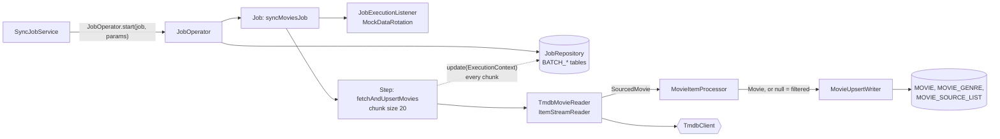
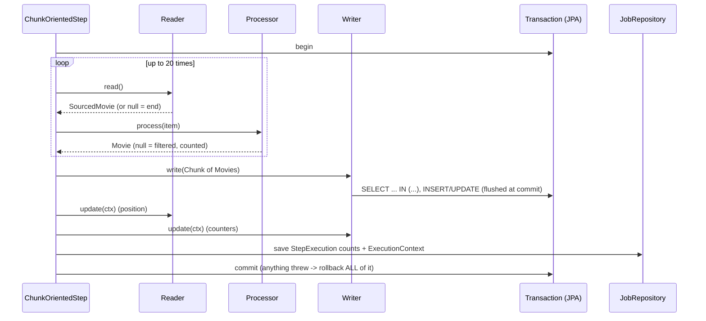
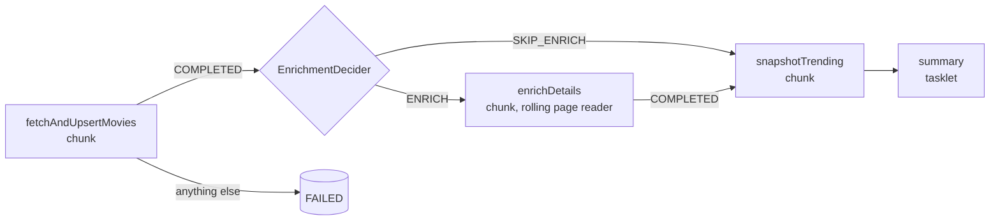
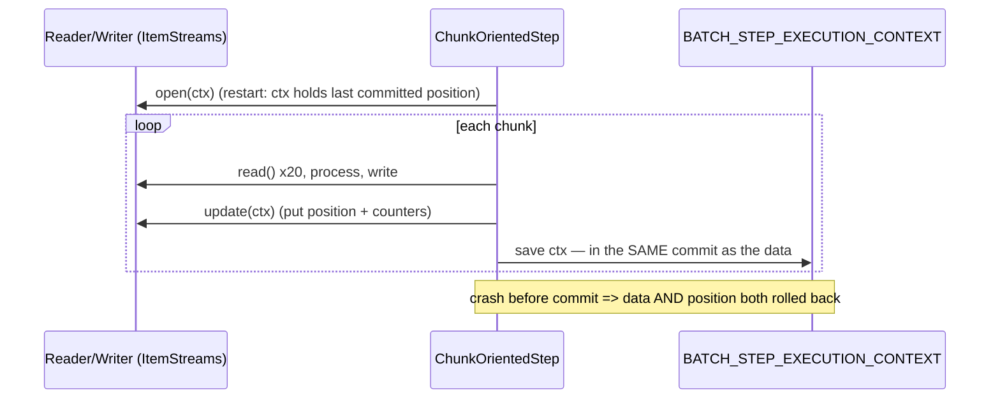
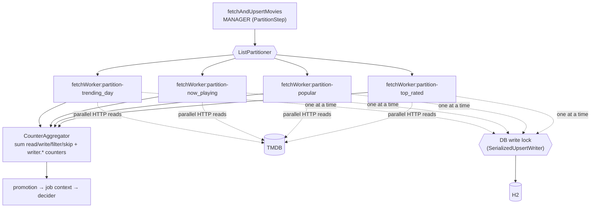
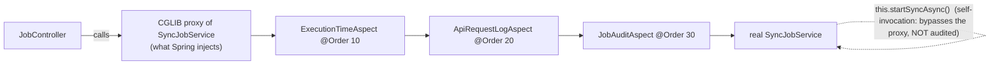

# Learning Log

A running record of what was built in each phase and what you should understand from it.

---

## Phase 1 — Skeleton

### What was built
A Spring Boot 4.1.2 application that starts, creates its database schema (including Spring Batch's `BATCH_*` metadata
tables), binds typed configuration, can fetch TMDB data (real or mock), and verifies connectivity at startup. No batch
job exists yet — this phase lays the ground it will stand on.

### Files and why they exist

| File | Why it exists |
|---|---|
| `mvnw.cmd`, `.mvn/wrapper/` | Maven wrapper: pins the Maven version and downloads it on first run — no global Maven install, same build for everyone. |
| `pom.xml` | Dependencies. Note Boot 4's **modular starters** (`starter-webmvc`, `starter-restclient`, separate `h2console` module, `-test` starter per module) and `starter-batch-jdbc`. |
| `application.yml` (+ `-tmdb`, `-mock`, `-demo`) | All configuration; profile files override only what differs. |
| `config/TmdbProperties`, `config/SyncProperties` | `@ConfigurationProperties` records: typed, validated, immutable settings. |
| `tmdb/TmdbClient` | Our own interface for "something that serves TMDB data". |
| `tmdb/TmdbApi` | Declarative `@HttpExchange` interface: endpoints described, implementation generated. |
| `tmdb/RestTmdbClient` + `config/TmdbClientConfig` | Real client (`RestClient`, timeouts, bearer token, throttling). Active unless profile `mock`. |
| `tmdb/MockTmdbClient` + `fixtures/*.json` | Offline client; simulates time passing so later syncs show inserts *and* updates. |
| `tmdb/dto/*` | Records mirroring TMDB JSON. Separate from entities on purpose. |
| `domain/*` | JPA entities: `Movie`, `Genre`, `TrendingSnapshot`, `SyncRun`, `RejectedRecord`. |
| `repository/*` | Spring Data interfaces; implementations are generated. |
| `service/GenreCatalog` | Fetches genres once, stores them, caches id → Genre in memory. |
| `tmdb/TmdbStartupCheck` | `ApplicationRunner` that logs the mode and checks connectivity; fails soft with advice. |
| `.gitignore`, `.gitattributes` | Keep `data/`, secrets and build output out of git; keep line endings correct. |
| `src/test/...` | Context smoke test, `MockTmdbClient` unit tests, JPA slice test. |

### Architecture so far

```mermaid
flowchart LR
    subgraph Profiles
      M[mock profile]
      T[default tmdb profile]
    end
    SC[TmdbStartupCheck<br/>ApplicationRunner] --> GC[GenreCatalog]
    GC --> C{{TmdbClient interface}}
    C -->|profile = mock| MC[MockTmdbClient<br/>fixtures/*.json]
    C -->|profile != mock| RC[RestTmdbClient]
    RC --> API[TmdbApi<br/>@HttpExchange proxy]
    API --> RST[RestClient<br/>timeouts + Bearer token]
    RST --> TMDB[(api.themoviedb.org)]
    GC --> GR[GenreRepository]
    GR --> H2[(H2 file DB<br/>MOVIE GENRE ... BATCH_*)]
```

### Key concepts and how they work internally

**Maven wrapper.** `mvnw.cmd` reads `.mvn/wrapper/maven-wrapper.properties`, downloads the named Maven into `~/.m2/wrapper`,
and runs it. That is why you never need `mvn` installed.

**`@SpringBootApplication`.** Three annotations in one: `@Configuration` (this class can declare beans),
`@ComponentScan` (find `@Component`/`@Service`... under `com.moviepicker`), `@EnableAutoConfiguration` (conditionally
create beans based on the classpath: with JPA + H2 on it you get a `DataSource`, `EntityManagerFactory`, transaction
manager; with `batch-jdbc` you get a `JobRepository`, `JobOperator` and the schema initializer).

**`spring-boot-starter-batch-jdbc` vs plain `starter-batch`.** In Boot 4 the plain starter wires a
`ResourcelessJobRepository` (nothing is persisted, no restart possible). The `-jdbc` flavour persists to the `BATCH_*`
tables. Those tables are what make restartability, history, and "is a job already running?" possible.

**`@ConfigurationProperties` records.** Boot binds `moviepicker.tmdb.*` onto the record's constructor. Relaxed binding means
`pages-per-list`, `pagesPerList` and an env var all map to the same component. `@Validated` runs Bean Validation at startup —
a wrong value stops the app with a readable error instead of failing at 3 a.m. The token is bound from
`${TMDB_API_TOKEN:}` — the *only* place the secret enters the app.

**Profiles.** `spring.profiles.default: tmdb` applies **only if no profile is active**. So `mock,demo` replaces it, and
`demo` alone would run with *neither* `tmdb` nor `mock`. That is why the real client is `@Profile("!mock")` ("everything
except mock") and not `@Profile("tmdb")`.

**RestClient vs RestTemplate vs WebClient.** RestTemplate: legacy, maintenance mode. WebClient: reactive, great for non-blocking
stacks, pointless overhead here (we would `.block()` everywhere). RestClient: synchronous, fluent, modern, and the engine
under `@HttpExchange`. Always set connect **and** read timeouts — without them one stuck connection stalls the whole job.

**`@HttpExchange` interface.** You write an interface, `HttpServiceProxyFactory` generates a JDK dynamic proxy at startup
that translates calls into `RestClient` requests. Same idea as Spring Data repositories or Feign.

**Dependency inversion with `TmdbClient`.** Batch code will depend on the interface only; the profile decides the
implementation. That is what lets the whole app (and tests) run with no network.

**JPA entity lifecycle.** `new Movie(...)` = *transient*. After `persist/save` in a transaction = *managed* (the persistence
context tracks it; changes are detected by **dirty checking** and flushed as UPDATE at commit — `GenreCatalog` relies on
this when it just calls `setName`). After the transaction/EntityManager closes = *detached*. `remove` = *removed*.

**Why `tmdbId` is the upsert key.** The internal `id` is unknown until insert; `tmdbId` identifies "the same movie" across
runs. A `UNIQUE` constraint on it means even two overlapping runs cannot create duplicates (the second insert fails
loudly). `equals/hashCode` are also based on it (not on the generated id, which is null before persist).

**Fetch types and N+1.** `@ManyToMany`/`@ElementCollection` are `LAZY`: loading 20 movies does *not* load genres. Touching
`movie.getGenres()` in a loop then fires 1 query per movie → **N+1** (1 + 20 queries). Fixes: `JOIN FETCH`, `@EntityGraph`,
or `@BatchSize`. We keep `open-in-view: false` so lazy loading outside a transaction fails fast instead of hiding the problem.

**`@Version`.** Optimistic locking: UPDATE is `... WHERE id=? AND version=?`; zero rows updated ⇒ someone else changed it ⇒
`OptimisticLockException`. No DB lock is held, hence "optimistic". The test `versionIsIncrementedOnUpdate` shows 0 → 1.

**SEQUENCE vs IDENTITY ids.** IDENTITY forces an immediate INSERT to learn the id, which disables JDBC batching. SEQUENCE
with `allocationSize=20` reserves 20 ids per call and lets Hibernate batch inserts (`hibernate.jdbc.batch_size: 20`,
confirmed in the log: *"Automatic JDBC statement batching enabled (maximum batch size 20)"*).

**SyncRun table vs reading `BATCH_*`.** `BATCH_STEP_EXECUTION` has read/write/filter/skip counts but cannot distinguish
inserted from updated, is Spring Batch's internal schema, and may be purged. Our own small table has stable business meaning
and is cheap to query; cost = duplicated information we must keep consistent (Phase 4).

**`ApplicationRunner`.** Executed once after the context has started. Our check logs instead of throwing, because the API and
H2 console are still useful without TMDB.

**`ddl-auto: update`.** Hibernate alters the schema to match entities. Convenient for learning, dangerous in production
(no review, no rollback, no data migration). Production: Flyway/Liquibase + `validate`.

**H2 file DB + `AUTO_SERVER=TRUE`.** A file-mode H2 database is opened by **one** process at a time. `AUTO_SERVER` makes the
first process also listen on a TCP port and writes it to `moviedb.lock.db`; later processes connect through it. Verified in
this phase: a second JVM queried the DB while the app was running. The `.lock.db` file is deleted on clean shutdown; after a
force-kill it stays, but H2 detects it is stale.

### What you will see

**Logs (mock profile):**
```
TMDB mode: MOCK - serving JSON fixtures, no network access, no token needed.
TMDB connectivity check OK: loaded 19 genres (lists to sync: [TRENDING_DAY, NOW_PLAYING, POPULAR, TOP_RATED], 3 page(s) each).
```
**Logs (no profile, no token):** `No active profile set, falling back to 1 default profile: "tmdb"` followed by a boxed
`TMDB_API_TOKEN is not set ...` message with the exact PowerShell commands.

**Tables (H2):** `BATCH_JOB_INSTANCE`, `BATCH_JOB_EXECUTION`, `BATCH_JOB_EXECUTION_PARAMS`, `BATCH_JOB_EXECUTION_CONTEXT`,
`BATCH_STEP_EXECUTION`, `BATCH_STEP_EXECUTION_CONTEXT` (+ 3 `BATCH_*_SEQ` sequences) — all still **empty** because no job
has run. Ours: `MOVIE`, `GENRE` (19 rows), `MOVIE_GENRE`, `MOVIE_SOURCE_LIST`, `TRENDING_SNAPSHOT`, `SYNC_RUN`,
`REJECTED_RECORD`. Hibernate also creates `HTE_*` tables; those are its internal helper tables for bulk operations — ignore them.

### Boot 4 / Batch 6 things to notice
- Starters are modular and each has a matching `-test` starter; the H2 console is a separate module.
- JSON uses **Jackson 3** (`tools.jackson.*` packages; annotations still in `com.fasterxml.jackson.annotation`).
- `@DataJpaTest` lives in `org.springframework.boot.data.jpa.test.autoconfigure`.
- `schema-h2.sql` for Batch 6 is plain `CREATE TABLE`; Boot's initializer tolerates re-running it on an existing file.

### Common mistakes
1. Using `@Profile("tmdb")` on the real client → `-Dspring-boot.run.profiles=demo` leaves you without a client.
2. Forgetting quotes around `-Dspring-boot.run.profiles=mock,demo` in PowerShell → the comma splits the argument.
3. Using IDENTITY ids and wondering why batch inserts are not batched.
4. Parsing TMDB's `""` release date straight into `LocalDate` → whole page fails. (Hence `String` in the DTO.)
5. Putting `@Transactional` on a method called from the *same* class → proxy bypassed, no transaction.
6. Leaving a Java process running → H2 file stays locked (or the next start reports a lock/port conflict).
7. Committing `data/` or the token.

### Check questions
1. Why does `RestTmdbClient` use `@Profile("!mock")` instead of `@Profile("tmdb")`? What would break with `-Dspring-boot.run.profiles=demo`?
2. Two sync runs overlap and both try to insert movie 550. Which two things in `Movie` stop a duplicate, and how do they differ (one is about *inserts*, one about *updates*)?
3. You load 20 movies with `findAll()` and print each movie's genre names (`open-in-view: false`, no transaction). What happens, and what would happen with a transaction? Name one fix for the second case.

---

## Phase 2 — `syncMoviesJob`, step 1 `fetchAndUpsertMovies`

### What was built
The first real Spring Batch job: it reads movies from TMDB (or the mock) list by list and page by page, transforms and
filters them, and idempotently upserts them into H2 in chunks of 20, with the reader's position saved so a restart can
resume. It is launched through `JobOperator` with a unique identifying parameter.

### Files and why they exist

| File | Why it exists |
|---|---|
| `batch/SourcedMovie` | What the reader emits: the DTO plus list, page and rank (provenance needed later). |
| `batch/TmdbMovieReader` | Custom paginated `ItemStreamReader`; position saved in the `ExecutionContext`. |
| `batch/MovieItemProcessor` | DTO → `Movie`, resolves genres, **filters** (null) adult/undated, **validates** (throws). |
| `batch/InvalidMovieException` | The "this data is corrupt" signal; Phase 3 skips it. |
| `batch/MovieUpsertWriter` | Idempotent upsert by `tmdbId`; counts inserted/updated/unchanged; stores counters in the context. |
| `domain/Movie.refreshFrom` | The "update only what changed, never touch runtime/tagline" rule, kept in the domain. |
| `batch/MovieSyncJobConfig` | Wires reader/processor/writer into a chunk step and the step into the job. |
| `batch/MockDataRotationListener` | `JobExecutionListener` (mock only): data "ages" per JobInstance. |
| `service/SyncJobService` | The single place that launches the job via `JobOperator` (scheduler, REST API and tests will all use it). |
| `scheduler/StartupSyncRunner` | Dev switch to run one sync at startup. |
| `config/ClockConfig` | Injectable `Clock` for testability. |
| `MovieRepository.findAllByTmdbIdIn` + `@EntityGraph` | One query per chunk, with collections fetched: no N+1. |

### Architecture



One chunk, in time order (this is the part to be able to draw on a whiteboard):



### Key concepts and how they work internally

**Job / JobInstance / JobExecution / Step / StepExecution.** `Job` = definition. `JobInstance` = job name + *identifying*
parameters (the logical run). `JobExecution` = one attempt at an instance (a restart creates a new execution of the
same instance). `StepExecution` = one attempt at one step inside an execution, holding read/filter/write/commit/skip counts
and the step's `ExecutionContext`. All persisted in `BATCH_*` by the `JobRepository`.

**JobOperator (Batch 6) vs JobLauncher.** `JobOperator` extends `JobLauncher` and adds `restart`, `stop`, `abandon`, queries.
`JobLauncher`/`JobExplorer` are deprecated; history is queried through `JobRepository`
(`getJobInstanceCount`, `getLastStepExecution`, ...).

**Identifying parameters.** `runAt` (identifying, epoch millis) makes every launch a new `JobInstance`; `trigger`
(non-identifying) is stored in `BATCH_JOB_EXECUTION_PARAMS` (column `IDENTIFYING` = `N`) but does not affect identity.
Same identifying parameters ⇒ same instance ⇒ a COMPLETED instance cannot run again
(`JobInstanceAlreadyCompleteException`), a FAILED one can be restarted.

**Chunk-oriented processing and the transaction boundary.** Reads and processes items one at a time, writes them as a
group, and wraps *each chunk* in one transaction. Small chunk = more commits (slower) but cheap retries and little
memory; large chunk = fewer commits but a failure throws away more work and the persistence context grows. We use 20,
aligned with `hibernate.jdbc.batch_size`. **Batch 6 gotcha:** the builder's default transaction manager is
`ResourcelessTransactionManager` (no transaction); we pass the JPA manager with `.transactionManager(...)`.
Because the reader position, writer counters, `StepExecution` counts and our data are saved in one commit, a crash can
never leave them out of step with each other.

**Processor contract.** return object → written; **return null → filtered** (counted in `filterCount`, not an error);
**throw → failure** (step fails unless skippable, Phase 3). Business rule vs corruption.

**ItemStream: open / update / close.** `open(ctx)` once at step start (restore state from `ctx` if restarting),
`update(ctx)` at the end of every chunk before commit (write state into `ctx`, saved to `BATCH_STEP_EXECUTION_CONTEXT`),
`close()` at the end. The step registers any reader/processor/writer that implements `ItemStream` automatically.
Our reader saves `(listIndex, page, offset)`; the test `restartResumesExactlyWhereTheLastCommittedChunkStopped` proves a
new reader instance continues at item 26 with nothing lost or duplicated.

**Why not `AbstractPaginatedDataItemReader`?** It restarts by "jump to item N" using a fixed page size; we walk several
lists of different lengths, so one counter cannot be mapped back to (list, page).

**`@StepScope` and late binding.** Bean created per step execution (a fresh reader each run, no leaked state) and able to
use `#{jobParameters['runAt']}` which only exists at launch. Implemented with a scoped proxy: that is why `@Bean` methods
return the concrete class, so the proxy still `instanceof ItemStream`. (`@JobScope` is the same idea at job level.)

**Idempotent upsert, and why keyed on `tmdbId`.** Scheduled jobs run again — on schedule, after failures, on restart,
accidentally twice. An INSERT-only writer duplicates or crashes; an upsert makes "run again" always safe. The business key
is the identity that survives between runs.

**JpaItemWriter vs custom writer vs JdbcBatchItemWriter(MERGE).**
`JpaItemWriter`: no code, but `merge()` = SELECT per item, no insert/update counts, no "keep runtime/tagline" rule.
Custom writer (ours): one `IN` query per chunk, full control, counts, Hibernate batching and `@Version`.
`JdbcBatchItemWriter` + `MERGE`: fastest, but bypasses Hibernate (no ManyToMany, no `@Version`) and is DB-specific.

**N+1 and `@EntityGraph`.** The writer compares genres/source lists of existing rows. Lazy loading would issue 2 extra
queries *per movie* (41 per chunk). `@EntityGraph(attributePaths = {...})` JOIN-FETCHes them into the single `IN` query.

**Persistence context per chunk.** The JPA `EntityManager` lives as long as the chunk transaction, so every chunk starts
with an empty first-level cache: memory stays flat however many chunks run.

**`@Version` in practice.** `MOVIE.VERSION` was 2 after a *single* run for a movie listed in three lists: it was updated
in three different chunks (0 → 1 → 2). Every UPDATE bumps it. Not a bug — but it shows what "touch `lastSyncedAt` on every
sync" costs: an UPDATE (and version bump) per row per sync. For a high-volume job you would skip unchanged rows.

**Counters survive restarts.** The writer's `inserted/updated/unchanged/repeats` live in the step context and are restored
in `open()`. (`repeats` = the same movie seen again via another list in the same run — 93 in the first run.)

### What you will see

Logs of a first run (mock, `JobInstance #1`):
```
Launching syncMoviesJob (trigger=startup)
Mock data generation for this run: 0 (JobInstance #1)
Reader starting fresh: 4 list(s) x up to 3 page(s)
Chunk written: 20 item(s) -> inserted=20 updated=0 unchanged=0
Chunk written: 19 item(s) -> inserted=11 ...        <- 19: the processor filtered one item of the 20 read
...
Step 'fetchAndUpsertMovies': status=COMPLETED read=143 filtered=5 written=138 commits=8 rollbacks=0 skips=0
```
Second run (new instance, generation 1): `inserted=2 updated=16`, ..., `read=149 filtered=6 written=143`.

`BATCH_*` after one run:

| Table | Content |
|---|---|
| `BATCH_JOB_INSTANCE` | 1 row: `syncMoviesJob` |
| `BATCH_JOB_EXECUTION` | status `COMPLETED`, start/end times |
| `BATCH_JOB_EXECUTION_PARAMS` | `runAt` (Long, `IDENTIFYING=Y`), `trigger` (String, `N`) |
| `BATCH_STEP_EXECUTION` | `READ_COUNT=143, FILTER_COUNT=5, WRITE_COUNT=138, COMMIT_COUNT=8, ROLLBACK_COUNT=0` |
| `BATCH_STEP_EXECUTION_CONTEXT` | Base64 of a serialised HashMap; decoded: `tmdb.reader.listIndex=4`, `tmdb.reader.list="(done)"`, `writer.inserted=45`, `writer.repeats=93`, `batch.stepType=...ChunkOrientedStep` |

Data: 45 movies, 124 `MOVIE_GENRE` rows, 138 `MOVIE_SOURCE_LIST` rows.
Note `COMMIT_COUNT=8` for 143 reads: ceil(143 / 20) = 8 chunks — the 5 filtered items still count as *read* and so as chunk members.

### Surprises worth remembering
- `read = filtered + written`: 143 = 5 + 138.
- Job instance IDs jumped 1 → 33 after a forced kill: H2 sequences cache 32 values, the unused ones are lost. IDs are identifiers, not counters.
- The step context is **not** human-readable text (Java serialisation + Base64). Query it with `JobRepository`.

### Common mistakes
1. Forgetting `.transactionManager(...)` on the Batch 6 chunk builder → no real chunk transaction.
2. Making the reader a singleton with state → the second run starts where the first one ended. (`@StepScope`.)
3. Returning an exception-throwing path for business filters instead of `null` → fails the step for normal data.
4. Same identifying parameters on every launch → `JobInstanceAlreadyCompleteException` on the second run.
5. Writer doing one `SELECT` per item (or a `findByTmdbId` in a loop) → N+1 inside every chunk.
6. Not merging duplicates *inside* a chunk → the same `tmdbId` inserted twice → unique constraint violation.
7. Putting counters in plain fields without `update()` → they vanish on restart.
8. Auto-running jobs at startup (`spring.batch.job.enabled=true`) and then wondering about the `JobInstanceAlreadyCompleteException`.

### Check questions
1. The chunk size is 20 and the writer throws on item 14 of the 3rd chunk. Which rows are in the DB, what does the step's saved `ExecutionContext` say, and what would a restart do?
2. A processor returns `null` for the adult movie. Which `StepExecution` counter changes, and does the item reach the writer? How is this different from throwing an exception?
3. Why is `runAt` identifying and `trigger` not? What would happen on the second scheduled run if both were non-identifying?


---

## Phase 3 — Fault tolerance (retry, skip, filter, reject)

### What was built
Real feeds misbehave. This phase teaches the job to survive three different kinds of trouble, each with a *different* tool:

| Trouble | Example | Tool | Where |
|---|---|---|---|
| The network is flaky | HTTP 429 / 5xx / timeout | **retry in the HTTP client** with exponential backoff + `Retry-After` | `ResilientTmdbClient` |
| One record is garbage | movie without title, rating 42 | **skip** the item, count it, store it | `MovieItemProcessor` → `InvalidMovieException` → `RejectedItemSkipListener` |
| The database hiccups | lock timeout, optimistic-lock clash | **retry the chunk** (Batch retry policy) | `MovieSyncJobConfig.faultTolerantFetchStep` |
| The record is fine but uninteresting | adult movie, no release date | **filter** (processor returns `null`) | `MovieItemProcessor` |
| Everything is broken | 11th bad record, 401 Unauthorized | **fail** the step (skip limit / permanent error) | `skipLimit`, `TmdbPermanentException` |

### Files and why they exist
| File | Why |
|---|---|
| `tmdb/RestTmdbClient` | Raw HTTP. Translates status codes into **two exception families**: `TmdbTransientException` (429, 5xx, timeouts; carries `Retry-After`) and `TmdbPermanentException` (other 4xx). `404` on a detail call → `TmdbNotFoundException`. Also throttles (min gap between calls). |
| `tmdb/ResilientTmdbClient` | `@Primary` **decorator** around the raw client. Retries only transient errors: `attempt n` waits `initialBackoff × multiplier^(n-1)` (capped), or `Retry-After` if the server sent one. Permanent errors are rethrown at once. Takes a `Consumer<Duration>` sleeper so tests run instantly. |
| `batch/InvalidMovieException` | The *marker* for "this single item is bad". Only this type is skippable. |
| `batch/RejectedItemSkipListener` + `domain/RejectedRecord` + `service/RejectedRecordService` | Every skipped item is written to `REJECTED_RECORD` (which list, which page, why). The service uses `REQUIRES_NEW` so the audit row survives even if the chunk transaction rolls back. |
| `config/MockProperties` + `tmdb/MockTmdbClient` switches | `rate-limit-calls`, `server-error-calls`, `corrupt-records`, `fail-once-at`, `latency-millis` let you *cause* each failure on demand. |

### How it works internally
**Why HTTP retry is not a Batch retry.** In Batch 6 the step's retry applies to *processing and writing* of a chunk, not to `reader.read()`. A 429 happens in the reader, so the only place to retry it is below the reader — hence the decorator. Rule of thumb: *retry at the layer that owns the failing operation*.

**Skip mechanics.** When the processor throws a skippable exception the framework: (1) calls `SkipListener.onSkipInProcess(item, ex)`, (2) bumps `SKIP_COUNT`, (3) **drops only that item** and goes on. If the *writer* throws a skippable exception the framework cannot tell which of the 20 items is the culprit: the classic fault-tolerant step rolls the chunk back and re-processes/re-writes the items **one at a time** to find it (a "scan"); we only exercise processor skips in this project, so check the Batch 6 reference before relying on the exact writer-scan behaviour. `skipLimit(10)` caps the total; item number 11 fails the step — a feed with >10 bad records is broken, hiding it would be wrong.

**Retry mechanics (Batch 6 / Framework 7).** `RetryPolicy.builder().includes(...).maxRetries(3).delay(200ms).multiplier(2.0)`. This is Spring *Framework's* `org.springframework.core.retry.RetryPolicy`, not the old spring-retry library. Observed: the retry **re-invokes the write inside the same transaction** (`ROLLBACK_COUNT` stays 0). That is fine for a lock timeout; it is *not* fine when the Hibernate session is poisoned by a failed flush (see Phase 8, where this bit us).

**Filter vs skip.** `null` from the processor = "not an error, just not for the writer": `FILTER_COUNT++`, no listener, no rollback. An exception = "something is wrong": rollback, skip bookkeeping, listener. Mixing them up is the single most common Batch mistake.

### What you will see
```
WARN  Skipping invalid record (list=popular page=1 #7 id=278): title is blank
Step 'fetchAndUpsertMovies': read=143 filtered=5 written=136 skips=2
```
`REJECTED_RECORD`: 2 rows (`tmdb_id` 278 "title is blank", 238 "vote average 42.0 out of range"). `BATCH_STEP_EXECUTION.SKIP_COUNT=2`.
With `MOVIEPICKER_MOCK_RATELIMITCALLS=2`: two `429` log lines, backoff waits, then success — the job never notices.

### Common mistakes
1. Catching and swallowing exceptions in the processor ("just log it") → data silently lost and Batch never learns.
2. Making *everything* skippable (`skip(Exception.class)`) → real bugs (NPE, mapping errors) vanish into the skip counter.
3. Retrying a non-idempotent operation. Retry is only safe because our writer is an upsert.
4. Retrying permanent errors (401/403): hammering an API with a bad token gets you banned.
5. Forgetting that `skipLimit` is for the *step*, not per chunk.

### Check questions
1. Why is retrying a 429 implemented in `ResilientTmdbClient` and not with `.retry(...)` on the step?
2. What is the difference, in counters and in side effects, between a processor returning `null` and throwing `InvalidMovieException`?
3. A writer fails on one item of a chunk of 20 and the exception is skippable. How does Batch find out *which* item, and what does that cost?

---

## Phase 4 — More steps, a decider, promotion, a listener

### What was built
`syncMoviesJob` grows from one step into a **flow**:



* **`enrichDetails`** — for movies that have no `detailsFetchedAt` yet, call `GET /movie/{id}` (runtime, tagline) and merge it in.
* **`snapshotTrending`** — store today's `trending_day` ranks in `TRENDING_SNAPSHOT` (this is what lets the API show *movement*).
* **`summary`** — a **tasklet** (one unit of work, no read/process/write) that logs the one-line result.
* **`EnrichmentDecider`** — chooses `ENRICH` if new movies were inserted or details are still pending, else `SKIP_ENRICH` (a no-change run does zero detail calls).
* **`SyncRunListener`** (a `JobExecutionListener`) — `beforeJob` creates a `SYNC_RUN` row, `afterJob` completes it and logs `SYNC RUN 2 COMPLETED in 252 ms: inserted=45 …`.

### Files and why they exist
| File | Why |
|---|---|
| `batch/SyncJobFlowConfig` | Steps + the flow DSL (`.on("COMPLETED").to(...)`, `.on("*").fail()`). `listeners.orderedStream().forEach(flow::listener)` attaches *every* `JobExecutionListener` bean. |
| `batch/RollingPageJpaReader` | A `JpaPagingItemReader` that **always reads page 0** (see below). |
| `batch/EnrichMovieProcessor`, `SnapshotProcessor` | Per-item logic for the two new chunk steps. |
| `batch/EnrichmentDecider` | `JobExecutionDecider` → returns a `FlowExecutionStatus` the flow routes on. |
| `batch/SummaryTasklet` | Reads counters and writes `SYNC_RUN`. |
| `batch/SyncRunListener` | Job-level lifecycle hook. |
| `domain/TrendingSnapshot`, `domain/SyncRun`, repos, `service/SyncRunService` | Persist and query the above. |
| `batch/MovieSyncJobConfig` (promotion) | `ExecutionContextPromotionListener` copies `writer.*` counters from the step context into the **job** context. |

### How it works internally
**Step context vs job context.** Each `StepExecution` has its own `ExecutionContext` (private, restart state). The `JobExecution` has another one shared by all steps. A later step or a decider can only see the **job** context, so values must be *promoted*. `ExecutionContextPromotionListener` does that in `afterStep` — **only if the step COMPLETED** (configurable). Pitfall we hit: the listener existed but was never *registered* with `.listener(promotion)` → counters silently stayed 0.

**Flow DSL.** `on("COMPLETED")` matches the step's **ExitStatus** (not BatchStatus — they can differ: a step can end `COMPLETED WITH SKIPS`). `"*"` matches anything. Once you declare *any* transition for a step you take over its routing, so we state the failure path explicitly (`.on("*").fail()`) instead of relying on defaults: explicit beats implicit, and the exit status of the job is then exactly what we chose. Transitions are evaluated top-down, first match wins.

**The rolling-page trap (very good interview material).** `enrichDetails` reads "movies without details" and the writer *fills them in*, so the query result shrinks while we read. A normal paging reader asks for page 0, then page 1, then page 2 … but after page 0 is processed, the rows that used to be on page 1 are now on page 0 → **half the rows are never visited**. Fix: always read page 0 (override `getPage()` to return 0) and let the shrinking result set do the paging; plus `transacted=false`/`saveState=false` because the "position" is meaningless here.

**Tasklet vs chunk.** A tasklet is *one* `execute()` call inside one transaction, repeated until it returns `FINISHED`. Right for housekeeping, wrong for bulk data (no chunking, no skip/retry per item, one giant transaction).

### What you will see
```
SYNC RUN 2 COMPLETED in 252 ms: inserted=45 updated=0 unchanged=0 read=83 filtered=1 skipped=0 enriched=45 snapshots=30
```
`BATCH_STEP_EXECUTION`: 4 rows per run (`fetchAndUpsertMovies`, `enrichDetails`, `snapshotTrending`, `summary`). A re-run with no new movies shows only 3 (enrich skipped).

### Common mistakes
1. Reading and modifying the same table with a plain paging reader (the rolling-page trap).
2. Not registering a listener you created.
3. Routing on `BatchStatus` strings instead of `ExitStatus`.
4. Putting a big data job in a tasklet.
5. Forgetting that promotion only happens for steps that finish.

### Check questions
1. Why does `enrichDetails` read page 0 forever, and what would happen with a standard `JpaPagingItemReader`?
2. How does the decider get the number of inserted movies, given that the writer lives in another step?
3. What happens to the job if `snapshotTrending` ends `FAILED` — and what would change if we removed the `.on("*").fail()` line?
   *(Careful: in Spring Batch an unmatched FAILED exit status normally ends the job FAILED anyway; the explicit `.fail()` makes the intent and the transition visible. Your answer should say what is explicit vs implicit.)*

---

## Phase 5 — Scheduling

### What was built
The job now runs itself. `SyncScheduler.tick()` is `@Scheduled(fixedDelayString = "${moviepicker.sync.interval:PT5M}", initialDelayString = …)`; the `demo` profile uses `PT30S`.

### Files and why they exist
| File | Why |
|---|---|
| `scheduler/SyncScheduler` | The trigger. `@ConditionalOnProperty(moviepicker.sync.enabled)` so tests/ops can switch it off. Blocks via `startSync("scheduler")`, absorbs `SyncAlreadyRunningException` (a normal condition) and any `RuntimeException` (the next tick must still happen). |
| `scheduler/SchedulerControl` | Pause/resume flag + last tick/outcome. Pausing does **not** cancel the scheduled task, each tick just checks the flag. |
| `service/SyncJobService` | One place that launches/restarts/stops; owns the **overlap guard** and the parameter policy. |
| `scheduler/StaleExecutionRecovery` | `ApplicationRunner`: at startup marks executions still `STARTED` (killed JVM) as `FAILED` so they can be restarted. |
| `scheduler/StartupSyncRunner` | `run-on-startup` convenience. |
| `config/SchedulingConfig`, `BatchExecutorConfig`, `ClockConfig` | `@EnableScheduling`; an async `@BatchTaskExecutor` so `JobOperator.start` returns immediately; an injectable `Clock`. |

### How it works internally
**fixedDelay vs fixedRate vs cron.** `fixedDelay` = wait N *after the previous run finished* (no overlap from a single scheduler, drifts). `fixedRate` = start every N regardless (can pile up). `cron` = wall-clock times. For a job whose duration varies, `fixedDelay` is the safe default.

**Job parameters decide JobInstances.** `JobInstance = job name + IDENTIFYING parameters`. A COMPLETED instance cannot be run again (`JobInstanceAlreadyCompleteException`). "Every 5 minutes" has no natural business key, so each launch adds `runAt = now` (**identifying**) → a *new* instance per run. `trigger = scheduler|manual|startup` is **non-identifying**: recorded for information, never changes identity. If `trigger` were identifying, a "manual" run and a "scheduler" run would be different instances, harmless; if `runAt` were *non*-identifying, the second scheduled run would be the *same* instance as the first and be refused.

**Overlap.** Different `runAt` = different instances, so Batch itself would happily run two syncs at once. `SyncJobService` checks `findRunningJobExecutions` and launches under one `synchronized` lock. That protects **one JVM only**; multi-pod needs a shared lock (ShedLock, a DB lock row, or a single scheduler node).

**Zombie executions.** If the JVM is killed mid-run the DB says `STARTED` forever, and Batch refuses to restart a "running" execution. `StaleExecutionRecovery` flips such rows to `FAILED` at startup. Only safe with a *single* instance — with several, "STARTED" might legitimately be another pod's job.

**Blocking the scheduler thread.** The default `@Scheduled` pool has ONE thread; a 20-minute job blocks other scheduled methods. Acceptable here (one job); otherwise use a pool or launch asynchronously.

### Common mistakes
1. `spring.batch.job.enabled=true` (default!) *plus* a scheduler → the job runs once at startup and once per tick.
2. Same parameters every time → second run fails.
3. Letting an exception escape `tick()` → harmless with `@Scheduled` (it logs), but a swallowed `Error` hides outages; we log and record the outcome.
4. Using `fixedRate` with long jobs.
5. Believing a JVM-local lock prevents double runs in a cluster.

### Check questions
1. A tick fires while the previous sync still runs. What happens, in which class, and what does the user see?
2. Why do we need `StaleExecutionRecovery`, and why is it dangerous with 3 pods?
3. Which of `fixedDelay`, `fixedRate`, `cron` would you pick for "sync every night at 02:00" and why?

---

## Phase 6 — Restartability

### What was built
Proof that a crash in the middle loses nothing and duplicates nothing: **fail at `popular:2` → `FAILED` → restart → `COMPLETED`, same `JobInstance`, new `JobExecution`, resumes from the saved position.**

Live demo (mock, `MOVIEPICKER_MOCK_FAILONCEAT=popular:2`, via the REST API):
```
POST /api/jobs/sync        -> executionId=1
run 1: FAILED   read=72 written=56 commits=3 rollbacks=1   movies committed before failure: 34
       cause: TmdbPermanentException: Simulated crash while fetching popular:2
POST …/executions/1/restart -> executionId=2
restart: COMPLETED, jobInstanceId 1 -> 1 (same instance)   inserted=45 …  movies now: 45
restart of a COMPLETED execution -> HTTP 409
```
Reads: 60 committed in run 1 + 83 in the restart = 143: **no item read twice, none lost.**

### How it works internally

* The position is saved **in the same transaction** as the business rows. That atomicity is the whole trick: you can never have "rows written but position not advanced" (duplicate work) or the reverse (lost work).
* On restart Batch finds the last `JobExecution` of the **same JobInstance** (same identifying params). Steps that `COMPLETED` are *not* run again; the failed step gets the **saved context** and the reader's `open()` resumes. `JobOperator.restart(execution)` creates the new `JobExecution`.
* `allowStartIfComplete`, `startLimit` exist to override these defaults. Not used here.
* Restarting needs the `BATCH_*` tables to be persistent: the reason for `spring-boot-starter-batch-jdbc` (plain starter = `ResourcelessJobRepository`, nothing to restart from).
* Restart re-fetches the current page and skips `offset` items, so it relies on the source being stable between runs. With real TMDB the page can shift; the idempotent upsert makes any re-read item harmless.

**Stop is not fail.** `POST …/stop` → `JobOperator.stop` sets a flag; the step finishes the *current chunk*, commits, and the execution ends `STOPPED` — restartable like `FAILED`.

### What you will see
`BATCH_JOB_INSTANCE` 1 row, `BATCH_JOB_EXECUTION` 2 rows (FAILED, COMPLETED). `BATCH_STEP_EXECUTION_CONTEXT` of the failed step: `tmdb.reader.listIndex`, `…page` and `…offset` of the last *committed* chunk (not of the page that crashed) and `writer.inserted=34`. The `SYNC_RUN` of the failed run says `inserted=34` (it reads the step context when the job context was never promoted).

### Surprises worth remembering
* The `exitDescription` of a failed step starts with a framework wrapper (`Unable to process chunk`); the useful line is the last `Caused by:` — the API returns that one.
* Instance/execution ids jump after a forced kill (H2 sequence cache = 32).
* Run 2 of a *new* instance in the mock sees "generation 1" data: rotation is keyed on the instance count, not the execution.

### Common mistakes
1. Changing identifying parameters when "restarting" → that is a *new* instance, nothing resumes.
2. Reader that does not implement `ItemStream` (or whose `update()` forgets state) → restart begins from zero.
3. Non-idempotent writer + restart → duplicates.
4. Restarting a job that is still `STARTED` (zombie) without recovery.
5. Storing huge objects in the `ExecutionContext` (it is serialised on every chunk commit).

### Check questions
1. Chunk size 20; the job dies during chunk 4 *after* the writer ran but before commit. What is in the DB and what is in the saved context?
2. Why must the restart use the same identifying parameters?
3. What is the difference in state between `FAILED` and `STOPPED`, and can both be restarted?


---

## Phase 7 — REST API and Postman

### What was built
A Spring MVC API that **reads** the data and **controls** the job (full list in the README). New concepts: DTOs vs entities, `Specification`-based filtering, paging/sorting safety, ProblemDetail error handling, `202 Accepted` for long operations, and a scoring formula.

### Files and why they exist
| File | Why |
|---|---|
| `web/MovieController`, `JobController`, `SchedulerController`, `AboutController` | **Thin** controllers: bind + validate input, call a service, return a DTO. `@Validated` + `@Min/@Max/@DecimalMin` on `@RequestParam`. |
| `web/ApiDtos` | All response **records**. Entities never leave the service layer (lazy-loading exceptions, N+1, accidental exposure, JSON cycles, a contract coupled to the table). |
| `service/MovieService` | Read logic, **`@Transactional(readOnly = true)`**, entity→DTO mapping *inside* the transaction (lazy collections). Sort-field whitelist. |
| `service/MovieSpecifications` | Dynamic `WHERE` with the JPA Criteria API: only supplied filters are added; parameterised; `LIKE` wildcards in user text are escaped; `distinct` when joining genres. `MovieRepository extends JpaSpecificationExecutor<Movie>`. |
| `service/PickScorer` | `score = WR × ln(1+votes) + recencyBonus` — pure function, unit tested (see the Javadoc for the maths: Bayesian weighted rating, log confidence, exponential recency decay). |
| `service/JobQueryService` | Maps Batch metadata (`JobExecution`, `StepExecution`) to DTOs; shows the **root cause** line of a failure. |
| `web/ApiExceptionHandler` | `@RestControllerAdvice` extending `ResponseEntityExceptionHandler` → every error is `application/problem+json` (RFC 9457). |
| `postman/*.json` | Collection (with a test script that stores `executionId`) + environment (`baseUrl`, no secrets). |
| `application.yml` | `spring.data.web.pageable.max-page-size=50`: `?size=100000` silently becomes 50. |

### How it works internally
* **`Pageable` resolution.** `PageableHandlerMethodArgumentResolver` builds it from `?page=&size=&sort=field,dir`. `Page<T>` carries content + total (an extra `COUNT` query using the *same* Specification). We wrap it in our own `PageResponse` so the JSON contract is ours, not Spring Data's.
* **N+1 control.** `@BatchSize(50)` on the lazy collections turns "one query per movie per collection" into "one query per 50 movies" — a page of 20 costs ~4 statements. `findAllByTmdbIdIn` uses `@EntityGraph` (join fetch) for the trending list.
* **Why 202.** A sync can take minutes; holding the HTTP request open ties up a thread and hits proxy timeouts. `POST /api/jobs/sync` returns `202 Accepted` + `Location: /api/jobs/executions/{id}` and the client polls. `JobOperator` is asynchronous because of the `@BatchTaskExecutor`.
* **Status-code rules of thumb.** 400 = your input is wrong (bad sort field, `minRating=11`); 404 = it does not exist; 409 = valid request, wrong state (a sync is already running, restarting a COMPLETED execution); 500 = our bug (logged, never leaked).
* **Validation in Spring 7.** Constraint annotations directly on controller parameters are handled by the framework's *method validation* → `HandlerMethodValidationException` (not `ConstraintViolationException`). Our advice maps both. **Gotcha we hit:** `ResponseEntityExceptionHandler` already handles `HttpMessageNotReadableException` and type mismatches; declaring your own handler for them throws `Ambiguous @ExceptionHandler method` and the *whole context fails to start*.
* **Open-in-view is off** (`spring.jpa.open-in-view=false`): lazy loading in the controller/JSON layer is impossible by design, which forces correct DTO mapping.

### What you will see
```
GET /api/movies/picks?limit=3
 89.01  Interstellar | 88.89  The Shawshank Redemption | 88.35  The Dark Knight
GET /api/movies/987654321   -> 404 application/problem+json {"title":"Not found","status":404,"detail":"No movie with tmdbId 987654321"}
GET /api/movies?sort=overview,asc -> 400 "Cannot sort by 'overview'. Allowed: [lastSyncedAt, popularity, ...]"
```

### Common mistakes
1. Returning entities (or `Page<Entity>`) from controllers.
2. Letting clients sort by any property (unindexed columns, internal fields) or request unbounded page sizes.
3. Building SQL strings for optional filters instead of `Specification`s; forgetting to escape `%`/`_` in `LIKE`.
4. `200 OK` + body "started" for a long operation.
5. Mapping `404` to "empty list" — hides typos.
6. Swallowing the cause: return `500` with a stack trace in the body (leak) or with nothing in the log (blind).

### Check questions
1. Why do the controllers return `MovieDto` and not `Movie`? Name three concrete things that break otherwise.
2. `POST /api/jobs/sync` answers `202`. What does the client do next, and what would be wrong with `200` after waiting for the job?
3. A client sends `?sort=voteAverage,desc&size=100000&genre=Drama`. Walk through what the request becomes in SQL terms (filters, sort, page size, extra queries).

---

## Phase 8 — Partitioning

### What was built
`moviepicker.sync.partitioned=true` replaces the single fetch step with a **manager step** and four **worker steps** (one per TMDB list) running in parallel threads. Same result (45 movies, no duplicates, `COMPLETED`), different execution shape. Off by default.



### Files and why they exist
| File | Why |
|---|---|
| `batch/ListPartitioner` | `Partitioner.partition(gridSize)` → `{partitionName → ExecutionContext}`; here `{"partition-popular" → {listName=popular}, …}`. |
| `batch/PartitionedFetchConfig` | `@ConditionalOnProperty`; defines the **same bean name** `fetchAndUpsertMovies` as the plain config (only one active → the job flow is untouched), a `@StepScope` reader reading `#{stepExecutionContext['listName']}`, the worker step and the manager via `.partitioner(workerName, partitioner).step(worker).taskExecutor(...).aggregator(...)`. |
| `batch/CounterAggregator` | The built-in `DefaultStepExecutionAggregator` sums the *framework* counters but not our `writer.*` context values; this adds them, so promotion/decider/summary work unchanged. |
| `batch/SerializedUpsertWriter` | Serialises the DB write (see below). |
| `MovieSyncJobConfig.faultTolerantFetchStep` | Refactored so the plain step and every worker share the same fault-tolerance setup. |
| `SyncRunService.stats` | Ignores step names containing `:` (workers) so nothing is double counted. |

### A real concurrency bug, found by running it
First version: four workers, each with its own writer, `DataIntegrityViolationException` retry. Result: **5 of 5 runs FAILED.** The mock lists overlap heavily (143 reads → 45 distinct movies), so two workers both `SELECT` "not found", both `INSERT`, and the second hits the unique key on `tmdb_id` (plus row-lock timeouts when they update the same rows in different order). The step's retry did not help: Batch 6 re-invokes the *write in the same transaction*, but the Hibernate session is already poisoned by the failed flush, so every retry fails identically.

Fix: **parallelise the slow part (HTTP), serialise the fast and contended part (DB).** `SerializedUpsertWriter` wraps the upsert in a static `ReentrantLock` and a `REQUIRES_NEW` transaction that **commits before the lock is released**, so the next worker's `SELECT` always sees the previous rows. Result: 5/5 repeated runs green.
Trade-offs to be able to explain: (1) the lock is JVM-local; (2) the chunk is no longer *one* atomic unit — rows commit, then the step commits its position; a crash in between leaves rows without an advanced position, and the restart re-processes the chunk harmlessly because the writer is an **idempotent upsert**; (3) the better design is to partition by **disjoint keys** (e.g. `tmdbId % 4`, id ranges). "One list per worker" is a fine key for *reading*, a poor one for *writing* because lists overlap.

### Which scaling tool when
| Tool | Idea | Restartable? | Use when | Catch |
|---|---|---|---|---|
| **Multi-threaded step** (`taskExecutor` on a chunk step) | N threads share one reader/writer | No (must set `saveState=false`) | Quick win for a thread-safe reader | Reader must be thread-safe; chunk order lost |
| **Partitioning** (this phase) | Split input into independent slices; each slice is a full step | **Yes, per partition** (only failed partitions re-run) | Input is naturally divisible | Needs a disjoint key; more `BATCH_*` rows |
| **Remote partitioning** | Same, workers on other machines via messaging | Yes | One JVM is not enough | Middleware, shared DB, ops complexity |
| **Remote chunking** | One reader on the manager ships items to remote processors/writers | Manager-side only | *Processing* is the bottleneck, reading is cheap | Durable broker, delivery guarantees |
| **Parallel steps / split flows** | Different steps at once | n/a | Independent steps | A different axis, not for one big step |

**Why parallelism is capped here:** all workers share one throttled TMDB client (`request-interval`), so extra threads queue on the rate limit. Partitioning is a teaching tool at this scale, not a speed-up.

### What you will see
`BATCH_STEP_EXECUTION` (partitioned run): `fetchAndUpsertMovies` (manager) + `fetchWorker:partition-trending_day|now_playing|popular|top_rated` + `enrichDetails`, `snapshotTrending`, `summary`. Manager `READ_COUNT=143` = sum of the workers. Threads in the log: `partition-1 … partition-4`.

### Common mistakes
1. Partitioning on a key that is not disjoint, then writing to the same rows.
2. Sharing one stateful reader/writer between workers instead of `@StepScope` per partition.
3. Forgetting the aggregator for custom context values.
4. Assuming a JVM lock works across instances.
5. Expecting more threads to beat an external rate limit.
6. Trusting a concurrent test that passed once: repeat it (`@RepeatedTest(5)` here).

### Check questions
1. The same movie is in "popular" and "top_rated". Describe exactly how the unsafe version fails and why Batch's retry could not fix it.
2. After a crash, how does a partitioned step restart — which partitions run again?
3. When would you choose remote chunking over partitioning?

---

## Phase 9 — Tests and verification

### What exists (67 tests; `.\mvnw.cmd clean verify` must be green after every phase)
| Layer | Tests | What they prove |
|---|---|---|
| Unit | `PickScorerTest`, `MovieItemProcessorTest`, `TmdbMovieReaderTest`, `ResilientTmdbClientTest`, `LastSyncHealthIndicatorTest`, `MockTmdbClientTest` | Pure logic, no Spring |
| HTTP client | `RestTmdbClientHttpTest` | A **real in-process stub server** (`com.sun.net.httpserver`): real sockets, real timeouts, 429 with `Retry-After`, 5xx, 404 |
| Persistence | `MovieRepositoryTest` (`@DataJpaTest`) | Mapping, unique key, queries |
| Job end-to-end | `MovieSyncJobIdempotencyTest`, `…RotationTest`, `…FaultToleranceTest`, `…SkipLimitTest`, `…RetryTest`, `…FlowTest`, `…RestartTest`, `…PartitionedTest` | The real job, real H2 (in memory), mock client |
| Control plane | `SyncControlTest`, `SyncSchedulerTest`, `SyncSchedulingIntegrationTest`, `StaleExecutionRecoveryTest` | Async launch, overlap refusal, stop/restart, scheduling, zombie recovery |
| HTTP API | `RestApiTest` (MockMvc) | Status codes, ProblemDetail, paging cap, 202 + `Location`, 409s |

### Decisions worth knowing
* **Stub server = the JDK's `HttpServer`**, not WireMock (Boot 4/Jetty compatibility risk) and not `MockRestServiceServer` (cannot test real timeouts).
* **`jdbc:h2:mem:${random.uuid}`** per Spring context: different cached contexts never share tables.
* **`@SpringBootTest` for jobs** (not `@SpringBatchTest` utilities) because we launch through our own `SyncJobService`, the real entry point.
* Tests found real bugs: the missing promotion registration, `EmptyResultDataAccessException` for unknown execution ids, the partition race, the all-or-nothing `inserted=0` on failed runs.

### Common mistakes
1. Mocking the database in a batch test: it hides exactly the transaction/flush behaviour you care about.
2. One shared in-memory DB across contexts.
3. Sleeping instead of polling `JobRepository`.
4. A concurrency test that runs once.
5. Asserting on log text instead of metadata/DB state.

### Check questions
1. Why is the HTTP client tested against a real socket server rather than a mocked `RestClient`?
2. How would you test "the job fails when 11 records are bad" without 11 fixture files?
3. What would you add to test the multi-pod scenario, and why can't the current suite prove it?

---

## Phase 10 — Aspect-oriented programming (AOP)

### What we are building, in plain English
Some behaviour does not belong to any one class: *"time this call"*, *"write down who launched the job"*, *"count every TMDB
request"*. If you put it inside the business classes you repeat it everywhere and bury the real logic. AOP lets you write it
**once**, in an **aspect**, and say *where* it applies with a **pointcut**. The business code stays clean and does not even know.

Spring Boot's AOP is **Spring AOP**: at startup Spring wraps matching beans in a **proxy**; calls from other beans hit the proxy,
which runs your **advice** and then delegates to the real object. (Full AspectJ instead rewrites bytecode at compile/load time.
We do not use it.)

### Vocabulary (say these five words correctly and you pass half the AOP questions)
| Word | Meaning | Here |
|---|---|---|
| Aspect | class with cross-cutting behaviour | `ExecutionTimeAspect`, `JobAuditAspect`, ... |
| Advice | one method of an aspect: *what* and *when* | `@Around`, `@Before`, ... |
| Pointcut | expression selecting *which* methods | `Pointcuts.jobControl()` |
| Join point | one matched call (always a method execution in Spring AOP) | `SyncJobService.restart(5)` |
| Weaving | linking aspects to targets | runtime proxies (Spring) vs bytecode (AspectJ) |

### Files and why they exist (all new, package `com.moviepicker.aop`)
| File | Concept it teaches |
|---|---|
| `Pointcuts` | **Named, reusable pointcuts**; `within`, `execution`, combining with `||` |
| `LogExecutionTime` + `ExecutionTimeAspect` | **`@Around`** and **annotation-driven** pointcuts; binding the annotation to a parameter; `finally`; `@Order` |
| `ApiRequestLogAspect` | **`@Before` / `@AfterReturning` / `@AfterThrowing`**, binding `returning`/`throwing`; what runs before `@RestControllerAdvice` |
| `AuditLog` + `JobAuditAspect` + `web/AuditController` (`GET /api/audit`) | A realistic cross-cutting concern; **self-invocation** |
| `TmdbCallMetricsAspect` | Pointcut on an **interface**; **Micrometer** timer; low-cardinality tags; **one call matched twice** (decorator + delegate) |
| `pom.xml` | `spring-boot-starter-aspectj` (Boot 4's new name for `starter-aop`) |

`MovieService.search/trending/picks` got `@LogExecutionTime`; nothing else in the existing code changed. That is the point.

### The five advice types, in one table
| Advice | Runs | Can change result / stop the call? | Used in |
|---|---|---|---|
| `@Before` | before the method (throwing here cancels the call) | no (can only veto by throwing) | `ApiRequestLogAspect` |
| `@AfterReturning` | after a normal return; sees the result | no | `ApiRequestLogAspect` |
| `@AfterThrowing` | after an exception; sees it (still rethrown) | no | `ApiRequestLogAspect` |
| `@After` | always, like `finally`; sees neither | no | (not used) |
| `@Around` | wraps the call; **you** call `proceed()` | **yes**: arguments, result, exception, skip the call | the other three aspects |

Order for one call: `Around(before)` → `Before` → **method** → `AfterReturning`/`AfterThrowing` → `After` → `Around(after)`.
Rule of thumb: use the weakest advice that does the job. `@Around` that forgets `proceed()` silently disables the method.

### How the proxy changes what you inject

Spring Boot defaults to **CGLIB class proxies** (`spring.aop.proxy-target-class=true`): the proxy is a generated *subclass*.
So the class and its advised methods must not be `final`, and methods must not be `private`.
`AopUtils.isAopProxy(bean)` and `AopUtils.getTargetClass(bean)` tell the truth where `bean.getClass()` lies
(`AspectsIntegrationTest.beansThatMatchAPointcutAreReplacedByProxies`).

### Ordering (`@Order`)
Lower number = **outer** layer. `@Transactional` is itself an advisor with the *lowest* precedence, so our aspects (10–40) wrap
*outside* the transaction. Consequence: `ExecutionTimeAspect` measures transaction open + commit too. Give it a high number and
it would time only the method body inside the transaction. Same for audit: an audit entry is written even if the transaction
later rolls back, unless you order it inside.

### Self-invocation — the classic trap (and the test that proves it)
`SyncJobService.startSync()` calls `this.startSyncAsync()`. The audit pointcut matches **both** methods, yet a scheduled
`startSync` produces **one** audit entry, because the inner call never passes through the proxy
(`AspectsIntegrationTest.aLaunchIsAuditedOnceEvenThough...`). Fixes if you need the inner call advised: move it to another bean
(best), inject the bean into itself, or use AspectJ weaving. The same rule is why `@Transactional`, `@Async`, `@Cacheable` on a
method called from the same class silently do nothing.

### Things that are NOT advised (and why)
* `private`, `static`, `final` methods and calls on `this` (proxy limits).
* Objects you create with `new`: only Spring beans are proxied.
* Spring Batch's own step/chunk internals: we deliberately aspect only services, controllers and the TMDB client; proxying the
  `@StepScope` reader/writer beans would stack proxy on proxy for no benefit.
* Bean-validation errors on controller parameters: Spring MVC raises them before it calls the controller method.

### What appears where
* Console: `c.moviepicker.aop.ExecutionTimeAspect : MovieService.search(..) took 12 ms`, and a separate `AUDIT` logger line per
  launch/restart/stop/pause/resume.
* With the `demo` profile (or `logging.level.com.moviepicker.aop.ApiRequestLogAspect=DEBUG`): `-> MovieController.get(..)`,
  `<- ... returned MovieDto`, `!! ... threw MovieNotFoundException`.
* `GET /api/audit`: the in-memory audit trail, newest first.
* `GET /actuator/metrics/moviepicker.tmdb.calls` (then `?tag=client:ResilientTmdbClient`): **two** series per operation, the
  retry decorator (what the job experienced) and the raw client (every attempt). Compare counts to see how often retries happen.

### Common mistakes
1. Expecting an aspect to fire on a call inside the same class (self-invocation).
2. `@Around` without `proceed()`, or swallowing the exception: the contract of the method changes.
3. A pointcut that is too wide (`execution(* *(..))`): proxies everything, slows startup, advises Spring internals.
4. High-cardinality metric tags (ids, page numbers): unbounded memory.
5. Logging arguments blindly in an aspect that also covers a login/payment method: leaks secrets.
6. Putting business rules in an aspect: invisible logic. Aspects are for orthogonal, mechanical concerns.
7. Forgetting `@Component` on an `@Aspect` class: it silently does nothing.

### Check questions
1. A scheduled sync calls `startSync`, which calls `startSyncAsync`. Why is there one audit entry and not two?
2. Why is the timing aspect `@Order(10)` and what would change at `@Order(Ordered.LOWEST_PRECEDENCE)` on a `@Transactional` method?
3. `moviepicker.tmdb.calls` shows 9 timings for `ResilientTmdbClient` but 12 for `MockTmdbClient`. What happened?
